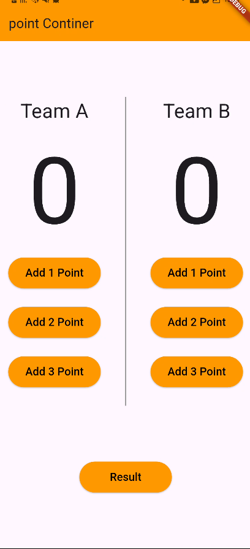
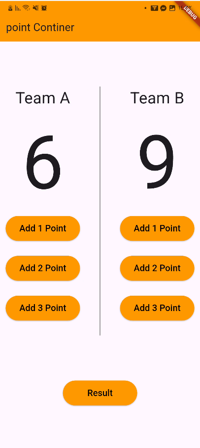

# Basketball Points Counter

A simple Flutter application for tracking basketball scores for two teams. Users can add 1, 2, or 3 points to either team, while the score is managed with the BLoC/Cubit pattern.

## Features

- Track scores for **Team A** and **Team B** independently.
- Add **1, 2, or 3 points** with a single tap.
- Update the interface automatically when a team score changes.
- Keep score logic separate from the UI with Cubit state management.

## Screenshots

> Add two screenshots to `assets/screenshots/` using the filenames below. They will appear automatically on GitHub.

| Initial screen | Score updated |
| :---: | :---: |
|  |  |

## Built With

- [Flutter](https://flutter.dev/) — UI framework
- [Dart](https://dart.dev/) — programming language
- [flutter_bloc](https://pub.dev/packages/flutter_bloc) — Cubit/BLoC state management
- Material Design widgets — app layout and controls

## Project Structure

```text
lib/
├── main.dart
└── manger/
    ├── counter_cubit.dart   # Score logic and state updates
    └── counter_state.dart   # States for Team A and Team B updates
```

## State Management

`CounterCubit` stores each team's score and exposes `teamIncrement()`. When points are added, it emits a state for the relevant team. `BlocProvider` makes the cubit available to the app, and `BlocConsumer` rebuilds the scoreboard when the state changes.

## Getting Started

### Prerequisites

- Flutter SDK (Dart SDK is included with Flutter)
- An emulator, simulator, browser, or physical device

### Installation

1. Clone the repository:

   ```bash
   git clone <https://github.com/Mina8496/Basketball-Points-Counter-App>
   ```

2. Open the project folder:

   ```bash
   cd Basketball-Points-Counter-App
   ```

3. Install dependencies:

   ```bash
   flutter pub get
   ```

4. Run the application:

   ```bash
   flutter run
   ```

## How to Use

1. Choose the team column you want to update.
2. Tap **Add 1 Point**, **Add 2 Point**, or **Add 3 Point**.
3. The selected team's score updates immediately.

## Future Improvements

- Implement the **Result** button to reset both scores.
- Add a match timer and team names.
- Add unit tests for `CounterCubit`.
- Improve responsiveness for smaller screens.

## Author

Created as a Flutter state-management practice project.
